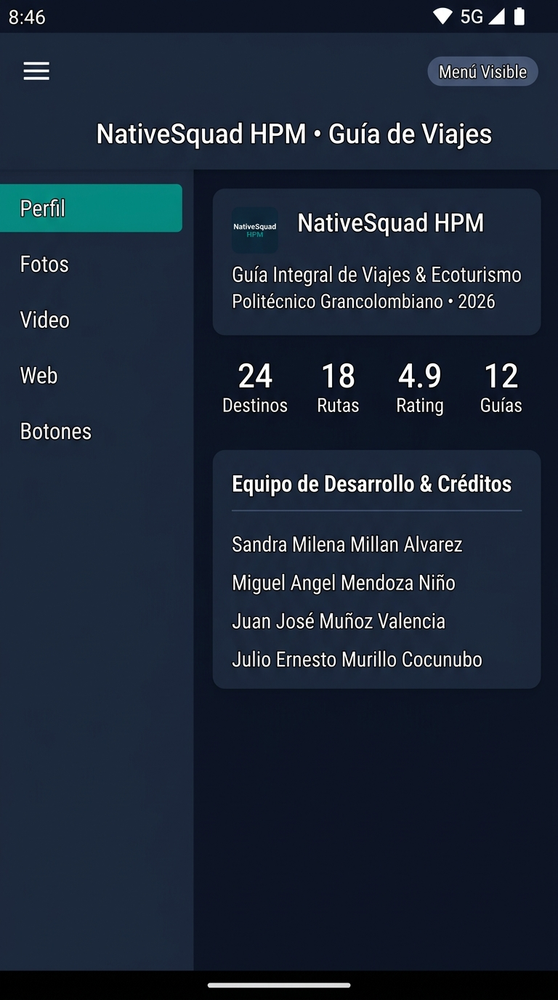
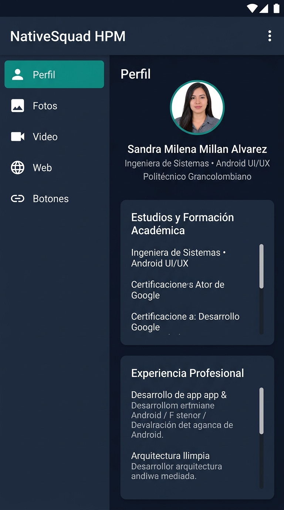
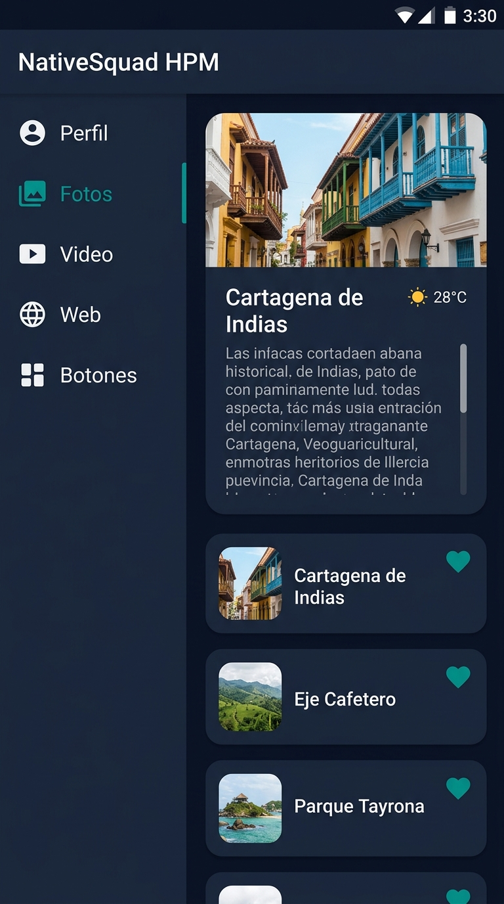
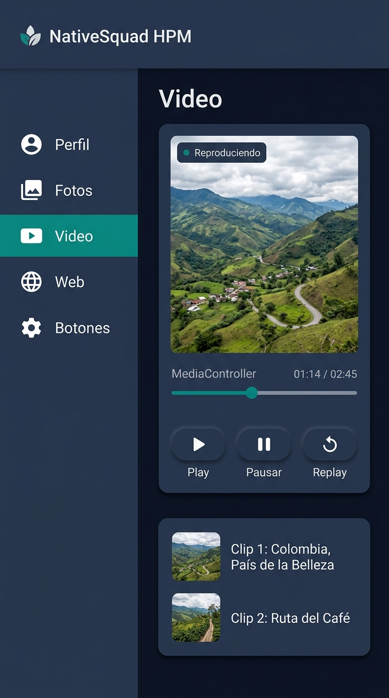
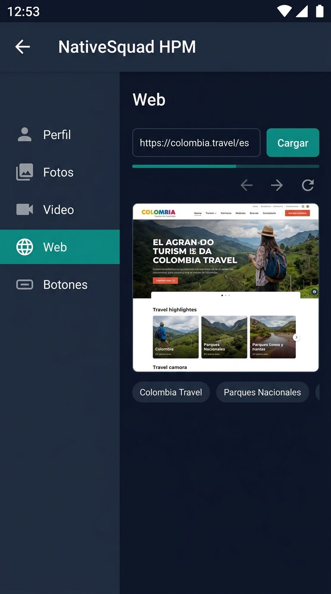
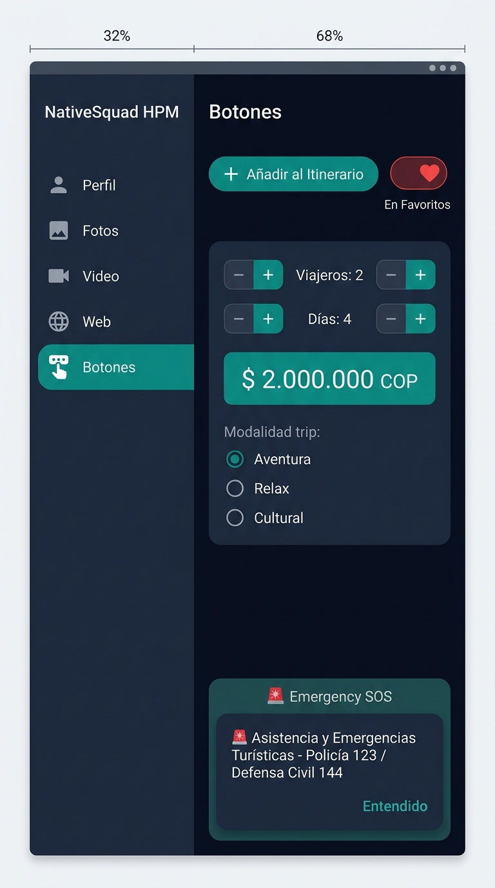

# INSTITUCIÓN UNIVERSITARIA POLITÉCNICO GRANCOLOMBIANO
## FACULTAD DE INGENIERÍA, DISEÑO E INNOVACIÓN
### MÓDULO: HERRAMIENTAS DE PROGRAMACIÓN MÓVIL I

---

# INFORME FINAL DE PROYECTO: ENTREGA 3 Y SUSTENTACIÓN (SEMANAS 7 Y 8)
## Aplicación Móvil Nativa Android: *NativeSquad - Guía Integral de Viajes Turísticos*

---

### 👥 Equipo de Trabajo (NativeSquad HPM):
* **Sandra Milena Millan Alvarez**
* **Miguel Angel Mendoza Niño**
* **Juan José Muñoz Valencia**
* **Julio Ernesto Murillo Cocunubo**

### 👨‍🏫 Docente / Tutor:
* **Víctor Fabián Castro Pérez**

### 🔗 Repositorio Oficial en GitHub:
* [https://github.com/MiguelAngel-Mendoza/NativeSquad](https://github.com/MiguelAngel-Mendoza/NativeSquad)

### 📅 Fecha de Entrega:
* Octubre de 2026 | Versión Final: 3.0 (Semanas 7 y 8)

---

## TABLA DE CONTENIDO

1. **SECCIÓN A: DOCUMENTO DE LA ENTREGA 1**
   - 1.1. Introducción y Contextualización del Proyecto
   - 1.2. Justificación y Planteamiento del Problema
   - 1.3. Objetivos del Proyecto (General y Específicos)
   - 1.4. Alcance y Público Objetivo
   - 1.5. Especificación Formal de Requerimientos (Funcionales y No Funcionales)
   - 1.6. Arquitectura Conceptual y Patrón de Diseño Móvil (Master-Detail con Dos Fragmentos)
   - 1.7. Diseño Preliminar de Interfaces y Wireframes
2. **SECCIÓN B: PANTALLAZOS DE LA APLICACIÓN EN EJECUCIÓN**
   - 2.1. Vista General de la Aplicación (Menú Lateral Izquierdo + Panel Dinámico)
   - 2.2. Módulo Perfil (Fotografía, Estudios, Experiencia y ScrollView en Textos)
   - 2.3. Módulo Fotos (Galería con Scroll en RecyclerView y Panel de Detalle al Seleccionar)
   - 2.4. Módulo Video (Reproductor Nativo VideoView con MediaController y Clips)
   - 2.5. Módulo Web (Caja de Texto URL, Botón Cargar y WebView Interno)
   - 2.6. Módulo Botones (Contadores, Toggle de Favoritos, Presupuesto, RadioGroup y Diálogo SOS)
   - 2.7. Modo Expandido / Pantalla Completa (Ocultamiento del Menú Lateral con Botón Hamburguesa)
3. **SECCIÓN C: INTERFAZ GRÁFICA JUNTO CON SU CÓDIGO XML**
   - 3.1. Arquitectura de Diseño y Google Material Design 3
   - 3.2. `activity_main.xml` (Actividad Principal Contenedora y Toolbar)
   - 3.3. `fragment_menu.xml` (Panel Lateral Izquierdo de Navegación)
   - 3.4. `fragment_bitacora.xml` (Módulo Perfil: Foto, Estudios, Experiencia y Textos con Scroll)
   - 3.5. `fragment_destinos.xml` (Módulo Fotos: Panel Dinámico y Lista con Scroll)
   - 3.6. `item_destino_card.xml` (Tarjeta Individual de Destino en RecyclerView)
   - 3.7. `fragment_experiencias.xml` (Módulo Video: VideoView y Controles de Reproducción)
   - 3.8. `fragment_portal_web.xml` (Módulo Web: EditText de URL y WebView)
   - 3.9. `fragment_acciones.xml` (Módulo Botones: Contadores, RadioGroup y AlertDialog)
   - 3.10. Recursos Gráficos, Estilos y Colores (`colors.xml`, `strings.xml`, `themes.xml`, Drawables)
4. **SECCIÓN D: CÓDIGO JAVA DE LA APLICACIÓN**
   - 4.1. Arquitectura de Clases, Ciclo de Vida y Desacoplamiento
   - 4.2. `MainActivity.java` (Actividad Contenedora, Transacciones y Visibilidad)
   - 4.3. `MenuFragment.java` (Panel de Navegación y Callback `OnMenuOptionSelectedListener`)
   - 4.4. `BitacoraFragment.java` (Lógica de Perfil, Integrantes y Scroll en Textos Extensos)
   - 4.5. `DestinosFragment.java` (Gestión de Galería y Callback `OnDestinoClickListener`)
   - 4.6. `DestinosAdapter.java` (Adaptador de RecyclerView y ViewHolders)
   - 4.7. `ExperienciasFragment.java` (Control Multimedia, VideoView y MediaController)
   - 4.8. `PortalWebFragment.java` (WebViewClient, WebChromeClient y Manipulación de URLs)
   - 4.9. `AccionesFragment.java` (Listeners OnClick, Cálculo de Presupuesto y AlertDialog)
   - 4.10. Modelos de Datos: `Destino.java` y `DestinosData.java`
5. **SECCIÓN E: CONCLUSIONES Y RECOMENDACIONES**
   - 5.1. Conclusiones Técnicas del Proyecto
   - 5.2. Recomendaciones de Escalabilidad y Trabajo Futuro
   - 5.3. Matriz de Cumplimiento con la Rúbrica del Tutor
6. **SECCIÓN F: GUION Y FICHA TÉCNICA DE SUSTENTACIÓN (SEMANAS 7 Y 8)**
   - 6.1. Estructura y Cronograma de la Presentación
   - 6.2. Asignación de Intervenciones para el Equipo (Sandra, Miguel, Juan, Julio)
   - 6.3. Banco de Preguntas Típicas del Tutor y Respuestas Técnicas

---

# SECCIÓN A: DOCUMENTO DE LA ENTREGA 1

### 1.1. INTRODUCCIÓN Y CONTEXTUALIZACIÓN DEL PROYECTO
El auge de los dispositivos móviles inteligentes y la omnipresencia del sistema operativo Android han transformado radicalmente la forma en que los usuarios acceden a la información, interactúan con servicios multimedia y planifican sus actividades cotidianas. En Colombia, el sector turístico y de ecoturismo representa uno de los motores económicos más dinámicos y de mayor proyección; no obstante, una gran proporción de las aplicaciones móviles existentes sufren de sobrecarga cognitiva, navegación fragmentada o una pobre optimización en pantallas de diversos factores de forma.

El proyecto **NativeSquad - Guía Integral de Viajes Turísticos** fue concebido dentro del módulo de **Herramientas de Programación Móvil I** del **Politécnico Grancolombiano** como una solución de software nativo para Android construida con lenguaje **Java**, aplicando las directrices oficiales de **Google Material Design 3** y orientada al cumplimiento estricto de la arquitectura de **dos fragmentos interactivos sincronizados**.

### 1.2. JUSTIFICACIÓN Y PLANTEAMIENTO DEL PROBLEMA
En el desarrollo de software para plataformas móviles tradicionales, es común observar aplicaciones que abren múltiples actividades (`Activity`) para cada sección, provocando un consumo elevado de memoria RAM, destrucción y recreación constante de contextos y una experiencia de usuario interrumpida con tiempos de espera innecesarios.

Adicionalmente, los usuarios viajeros y expedicionarios demandan una aplicación que consolide en un único entorno ergonómico:
1. Información del perfil y credenciales del guía o equipo expedicionario.
2. Galerías fotográficas con detalles históricos y geográficos bajo demanda.
3. Contenido audiovisual fluido con controles nativos de reproducción.
4. Navegación web integrada para consultar páginas oficiales sin abandonar el aplicativo.
5. Herramientas interactivas basadas en controles de botones para estimación de presupuestos, itinerarios y canales de auxilio inmediato.

**Pregunta Problema:**  
*¿Cómo diseñar e implementar una aplicación móvil nativa en Android que optimice el espacio en pantalla mediante una arquitectura sincronizada de dos fragmentos, garantizando alta fluidez, desacoplamiento modular y cumplimiento integral de los requerimientos de interacción y multimedia establecidos en la guía académica?*

### 1.3. OBJETIVOS DEL PROYECTO

#### Objetivo General:
Desarrollar una aplicación móvil nativa para el sistema operativo Android, denominada *NativeSquad - Guía Integral de Viajes*, implementando una arquitectura modular de dos fragmentos sincronizados (panel izquierdo de navegación y panel derecho dinámico de submódulos) que integre los módulos de Perfil, Fotos, Video, Web y Botones, garantizando una experiencia de usuario reactiva, ergonómica y de alto rendimiento.

#### Objetivos Específicos:
1. Diseñar e implementar la arquitectura modular con una actividad principal (`MainActivity`) que gestione la alternancia y visibilidad del panel de navegación lateral y el reemplazo dinámico de fragmentos vía `FragmentManager` y `FragmentTransaction`.
2. Construir el módulo **Perfil** incorporando fotografía de perfil, datos académicos y experiencia profesional, optimizando la lectura de campos tipo texto extensos mediante barras de desplazamiento vertical (`ScrollView`).
3. Desarrollar el módulo **Fotos** mediante un `RecyclerView` con desplazamiento suave (scroll) que permita visualizar la galería fotográfica de locaciones colombianas y despliegue la descripción histórica y geográfica dinámica al seleccionar cada imagen.
4. Implementar el módulo **Video** utilizando el componente nativo `VideoView` vinculado a `MediaController` táctil y controles programáticos de reproducción (Play, Pausa, Replay) con soporte de reproducción local offline.
5. Desarrollar el módulo **Web** embebiendo un componente `WebView` configurado con `WebViewClient` y `WebChromeClient`, complementado por una caja de texto (`EditText`) para digitación y navegación hacia cualquier URL.
6. Diseñar el módulo interactivo **Botones** demostrando el uso avanzado de controles táctiles: contadores de itinerario, botones toggle de favoritos con cambio de icono/texto, calculadora de presupuesto dinámico con `RadioGroup` y diálogos modales de asistencia de emergencia (`AlertDialog`).
7. Documentar y sustentar la solución integral desarrollada, evidenciando buenas prácticas de programación orientada a objetos en Java, diseño responsivo en XML y gestión eficiente del ciclo de vida móvil.

### 1.4. ALCANCE Y PÚBLICO OBJETIVO

* **Alcance:** Aplicación nativa Android compatible con versiones desde Android 7.0 Nougat (API 24) hasta Android 14 (API 34), desarrollada en Java 17 y Gradle 8.2, optimizada para dispositivos smartphones y tablets tanto en orientación vertical como horizontal.
* **Público Objetivo:** Usuarios expedicionarios, turistas nacionales e internacionales, estudiantes y docentes interesados en la exploración del patrimonio natural y cultural de Colombia, así como evaluadores académicos del módulo de Herramientas de Programación Móvil I.

### 1.5. ESPECIFICACIÓN FORMAL DE REQUERIMIENTOS

#### Requerimientos Funcionales (RF):

| Código | Nombre del Requerimiento | Descripción Detallada | Criterio de Aceptación |
| :--- | :--- | :--- | :--- |
| **RF-01** | Arquitectura de Dos Fragmentos | La aplicación debe dividir horizontalmente la pantalla principal en dos secciones: un panel izquierdo de opciones fijas y un panel derecho dinámico que muta según la opción seleccionada. | La pantalla no recarga la actividad principal al navegar; los fragmentos se intercambian en tiempo real con animaciones de desvanecimiento. |
| **RF-02** | Módulo Perfil (Bitácora) | Muestra el perfil de una persona con fotografía, formación académica, experiencia profesional y biografía. Para campos tipo texto se debe utilizar barra de desplazamiento (scroll) vertical para optimizar la pantalla. | Presencia de foto/avatar, campos de texto con `ScrollView` independiente para optimizar el espacio y opción de alternar entre los perfiles de los integrantes del equipo. |
| **RF-03** | Módulo Fotos (Destinos) | Lista de imágenes con barra de desplazamiento (scroll) vertical, en donde se muestra la descripción detallada (historia, geografía, clima, actividades) de cada imagen al ser seleccionada. | `RecyclerView` con scroll fluido y panel dinámico de detalle que se actualiza inmediatamente al pulsar sobre cualquiera de las tarjetas de destino. |
| **RF-04** | Módulo Video (Experiencias) | Muestra un reproductor de video nativo con controles de reproducción táctiles y programáticos. | Uso de `VideoView` con `MediaController` nativo, botones Play, Pausa, Replay y selector de clips HD locales desde la carpeta `res/raw`. |
| **RF-05** | Módulo Web (Portal Web) | Permite cargar una página Web cuya dirección URL se digita o modifica en una caja de texto (`EditText`). | Barra de URL editable, botón "Cargar", manejo de WebViewClient para mantener la navegación interna y barra de progreso de carga. |
| **RF-06** | Módulo Botones (Acciones) | Demostración integral del uso de controles de botones y gestión de eventos táctiles interactivos en tiempo real. | Botón con contador de clics, botón toggle con mutación de icono/texto, contadores (+/-) para estimación de presupuesto, `RadioGroup` y `AlertDialog` de auxilio SOS. |
| **RF-07** | Ocultamiento Dinámico del Menú | La barra superior debe incluir un botón de torta / menú hamburguesa para ocultar o desplegar el panel izquierdo a voluntad del usuario. | Al pulsar el botón, el menú lateral pasa a estado `GONE` o `VISIBLE`, expandiendo el fragmento derecho al 100% de la pantalla. |

#### Requerimientos No Funcionales (RNF):

* **RNF-01 (Rendimiento):** El intercambio de fragmentos en el panel derecho debe ejecutarse en un tiempo inferior a 150 milisegundos sin congelamiento de la interfaz gráfica.
* **RNF-02 (Compatibilidad):** El aplicativo debe operar sin dependencias externas obligatorias desde Android 7.0 (API 24) en adelante.
* **RNF-03 (Usabilidad & Estética):** Interfaz construida bajo Google Material Design 3, paleta de colores armónica (Teal, Marino, Coral, Ámbar), tipografía legible y microinteracciones visuales.
* **RNF-04 (Autonomía Offline):** Los videos locales y los recursos de galería deben estar embebidos en el paquete de la aplicación para garantizar funcionalidad sin conexión a Internet.
* **RNF-05 (Seguridad en Web):** La navegación web embebida debe prevenir redirecciones externas forzadas mediante el control seguro de `WebViewClient`.

### 1.6. ARQUITECTURA CONCEPTUAL Y PATRÓN DE DISEÑO MÓVIL
La solución se basa en el patrón de arquitectura **Master-Detail en Tiempo Real** implementado mediante fragmentos nativos de Android:

```text
┌─────────────────────────────────────────────────────────────────────────────┐
│ MainActivity (Toolbar superior + Botón Menú Hamburguesa + Indicador Estado) │
├──────────────────────────────────────┬──────────────────────────────────────┤
│ PANEL IZQUIERDO: MenuFragment        │ PANEL DERECHO: FrameLayout Dinámico  │
│                                      │                                      │
│ • [Opción 1: Perfil]   ───────────► │ BitacoraFragment (Foto, Scroll Text) │
│ • [Opción 2: Fotos]    ───────────► │ DestinosFragment (RecyclerView)      │
│ • [Opción 3: Video]    ───────────► │ ExperienciasFragment (VideoView)     │
│ • [Opción 4: Web]      ───────────► │ PortalWebFragment (WebView + URL)    │
│ • [Opción 5: Botones]  ───────────► │ AccionesFragment (Botones & SOS)     │
└──────────────────────────────────────┴──────────────────────────────────────┘
```

El desacoplamiento entre el menú izquierdo y el contenedor derecho se realiza a través de la interfaz callback `OnMenuOptionSelectedListener`, evitando acoplamiento directo entre fragmentos y delegando a `MainActivity` la orquestación del `FragmentManager`.

### 1.7. DISEÑO PRELIMINAR DE INTERFACES Y WIREFRAMES
En la fase preliminar se estructuró la distribución visual mediante un `LinearLayout` de orientación horizontal con pesos proporcionales: `layout_weight="0.32"` para el menú izquierdo y `layout_weight="0.68"` para el contenedor dinámico derecho, garantizando equilibrio en dispositivos móviles estándar de 5.5 a 6.7 pulgadas.

---

# SECCIÓN B: PANTALLAZOS DE LA APLICACIÓN EN EJECUCIÓN

### 2.1. Vista General de la Aplicación
Muestra la interfaz principal dividida horizontalmente en dos paneles sincronizados: el panel izquierdo con el logotipo corporativo de *NativeSquad*, el nombre de la aplicación y las 5 opciones de menú activas, y el panel derecho con el módulo cargado por defecto. En la parte superior se observa la barra de acción con el botón de menú hamburguesa y el badge de estado.



### 2.2. Módulo Perfil (`BitacoraFragment`)
Presenta la fotografía del perfil (`ic_avatar_person`), datos de identificación personal, rol y universidad. Incorpora chips táctiles para alternar instantáneamente entre los 4 integrantes del equipo (Sandra Millan, Miguel Mendoza, Juan Muñoz, Julio Murillo). Para los campos extensos de **Estudios** y **Experiencia Laboral**, se aprecian las barras de desplazamiento vertical (`ScrollView`) dedicadas que optimizan la pantalla y facilitan la lectura en pantallas compactas.



### 2.3. Módulo Fotos (`DestinosFragment`)
Despliega la galería fotográfica de locaciones de Colombia organizada verticalmente en un `RecyclerView` con scroll fluido (Cartagena, Eje Cafetero, Parque Tayrona, Caño Cristales, Medellín, San Andrés Islas). Al pulsar sobre cualquier tarjeta, el panel de detalle superior se actualiza dinámicamente con la imagen correspondiente, el título, el clima, y la reseña histórica, geográfica y actividades recomendadas dentro de un área con desplazamiento.



### 2.4. Módulo Video (`ExperienciasFragment`)
Contiene el componente `VideoView` nativo reproduciendo clips de alta definición almacenados en `res/raw`. Incluye la barra nativa de control `MediaController` y tres botones táctiles programáticos en la parte inferior: **Play**, **Pausar** y **Reiniciar**, así como un selector de clips temáticos (Colombia País de la Belleza, Ruta Cafetera y Caribe Colombiano).



### 2.5. Módulo Web (`PortalWebFragment`)
Permite ingresar o editar cualquier dirección URL en una caja de texto (`EditText`) con botón **Cargar**, integrando un navegador web embebido con `WebView` y barra de progreso. Incluye botones de navegación rápida (Atrás, Adelante, Recargar) y botones de acceso directo a sitios como *colombia.travel*, *Parques Nacionales Naturales* y el portal institucional del *Politécnico Grancolombiano*.



### 2.6. Módulo Botones (`AccionesFragment`)
Demuestra un amplio conjunto de botones y controles de interacción táctil:
1. Botón "Añadir al Itinerario" con contador incremental de toques.
2. Botón toggle "Marcar Favorito" que conmuta dinámicamente su texto e icono entre silueta y corazón relleno.
3. Calculadora de presupuesto turístico con botones incremento/decremento (+ / -) de viajeros y días con cálculo en moneda local (COP).
4. Grupo de botones de opción (`RadioGroup`) para seleccionar modalidad de viaje (Aventura, Relax, Cultural).
5. Botón de auxilio SOS que despliega un diálogo emergente modal (`AlertDialog`) con teléfonos de asistencia turística y botón de confirmación.
6. Botón de restablecimiento general.



### 2.7. Modo Expandido / Pantalla Completa
Al presionar el botón de menú hamburguesa en la barra superior, el panel izquierdo de navegación se oculta suavemente (`Visibility.GONE`), permitiendo que el panel dinámico derecho ocupe el 100% del ancho del dispositivo para una lectura inmersiva. Un nuevo toque en el botón restaura el menú lateral de forma inmediata.

---

# SECCIÓN C: INTERFAZ GRÁFICA JUNTO CON SU CÓDIGO XML

### 3.1. ARQUITECTURA DE DISEÑO Y GOOGLE MATERIAL DESIGN 3
La interfaz de usuario fue diseñada siguiendo las pautas de diseño accesible de Android:
* Estructura basada en contenedores semánticos (`LinearLayout`, `FrameLayout`, `CardView`).
* Paleta cromática profesional definida en tokens en `colors.xml`:
  * Fondo Principal: `@color/bg_main` (`#0F172A`) - Azul pizarra oscuro.
  * Fondo de Tarjetas: `@color/bg_card` (`#1E293B`) y `@color/bg_card_elevated` (`#334155`).
  * Color Primario: `@color/primary_teal` (`#0D9488`).
  * Acentos temáticos: `@color/accent_coral` (`#F43F5E`), `@color/accent_amber` (`#F59E0B`), `@color/accent_blue` (`#38BDF8`).

### 3.2. `activity_main.xml` (Actividad Principal y Toolbar)
```xml
<?xml version="1.0" encoding="utf-8"?>
<LinearLayout xmlns:android="http://schemas.android.com/apk/res/android"
    xmlns:tools="http://schemas.android.com/tools"
    xmlns:app="http://schemas.android.com/apk/res-auto"
    android:layout_width="match_parent"
    android:layout_height="match_parent"
    android:orientation="vertical"
    android:background="@color/bg_main"
    tools:context=".MainActivity">

    <!-- Barra Superior con Botón de Torta / Hamburguesa para Ocultar/Mostrar Menú -->
    <LinearLayout
        android:id="@+id/top_action_bar"
        android:layout_width="match_parent"
        android:layout_height="48dp"
        android:orientation="horizontal"
        android:gravity="center_vertical"
        android:background="@color/bg_menu"
        android:paddingHorizontal="10dp"
        android:elevation="4dp">

        <!-- Botón de Menú Hamburguesa / Torta -->
        <ImageButton
            android:id="@+id/btn_toggle_menu"
            android:layout_width="40dp"
            android:layout_height="40dp"
            android:background="?attr/selectableItemBackgroundBorderless"
            android:src="@drawable/ic_menu_toggle"
            android:tint="@color/primary_teal"
            android:padding="8dp"
            android:contentDescription="Ocultar o Mostrar Menú Lateral" />

        <TextView
            android:id="@+id/tv_top_bar_title"
            android:layout_width="0dp"
            android:layout_height="wrap_content"
            android:layout_weight="1"
            android:layout_marginStart="8dp"
            android:text="NativeSquad HPM • Guía de Viajes"
            android:textColor="@color/text_primary"
            android:textSize="13sp"
            android:textStyle="bold" />

        <!-- Indicador de estado del menú -->
        <TextView
            android:id="@+id/tv_menu_toggle_status"
            android:layout_width="wrap_content"
            android:layout_height="wrap_content"
            android:background="@drawable/bg_badge_pill"
            android:text="Menú Visible"
            android:textColor="@color/primary_teal"
            android:textSize="9sp" />
    </LinearLayout>

    <View
        android:layout_width="match_parent"
        android:layout_height="1dp"
        android:background="@color/border_stroke" />

    <!-- Contenedor Principal Dividido en Dos Secciones Horizontales -->
    <LinearLayout
        android:layout_width="match_parent"
        android:layout_height="0dp"
        android:layout_weight="1"
        android:orientation="horizontal">

        <!-- FRAGMENTO IZQUIERDO: Panel de Navegación Lateral (MenuFragment) -->
        <androidx.fragment.app.FragmentContainerView
            android:id="@+id/fragment_menu_container"
            android:name="com.nativesquad.guiadeviajes.fragments.MenuFragment"
            android:layout_width="0dp"
            android:layout_height="match_parent"
            android:layout_weight="0.32"
            tools:layout="@layout/fragment_menu" />

        <!-- Divisor vertical -->
        <View
            android:id="@+id/menu_divider"
            android:layout_width="1dp"
            android:layout_height="match_parent"
            android:background="@color/border_stroke" />

        <!-- FRAGMENTO DERECHO: Contenedor Dinámico de Submódulos -->
        <FrameLayout
            android:id="@+id/fragment_contenedor"
            android:layout_width="0dp"
            android:layout_height="match_parent"
            android:layout_weight="0.68"
            android:background="@color/bg_main">
            <!-- Los fragmentos se insertan dinámicamente mediante FragmentTransaction -->
        </FrameLayout>

    </LinearLayout>

</LinearLayout>
```

### 3.3. `fragment_menu.xml` (Panel Lateral Izquierdo)
```xml
<?xml version="1.0" encoding="utf-8"?>
<LinearLayout xmlns:android="http://schemas.android.com/apk/res/android"
    xmlns:tools="http://schemas.android.com/tools"
    android:layout_width="match_parent"
    android:layout_height="match_parent"
    android:orientation="vertical"
    android:background="@color/bg_menu"
    android:padding="12dp">

    <!-- Header / Logotipo de NativeSquad -->
    <LinearLayout
        android:layout_width="match_parent"
        android:layout_height="wrap_content"
        android:orientation="vertical"
        android:gravity="center"
        android:paddingTop="12dp"
        android:paddingBottom="16dp">

        <ImageView
            android:id="@+id/img_app_logo"
            android:layout_width="44dp"
            android:layout_height="44dp"
            android:src="@drawable/ic_logo_travel"
            android:contentDescription="@string/app_name" />

        <TextView
            android:id="@+id/tv_brand_name"
            android:layout_width="wrap_content"
            android:layout_height="wrap_content"
            android:layout_marginTop="6dp"
            android:text="@string/team_name"
            android:textColor="@color/text_primary"
            android:textSize="14sp"
            android:textStyle="bold" />

        <TextView
            android:id="@+id/tv_brand_tagline"
            android:layout_width="wrap_content"
            android:layout_height="wrap_content"
            android:text="Guía de Viajes"
            android:textColor="@color/primary_teal"
            android:textSize="11sp" />
    </LinearLayout>

    <View
        android:layout_width="match_parent"
        android:layout_height="1dp"
        android:background="@color/border_stroke"
        android:layout_marginBottom="12dp" />

    <!-- Opciones de Navegación Vertical en ScrollView -->
    <ScrollView
        android:layout_width="match_parent"
        android:layout_height="0dp"
        android:layout_weight="1"
        android:fillViewport="true"
        android:scrollbars="none">

        <LinearLayout
            android:layout_width="match_parent"
            android:layout_height="wrap_content"
            android:orientation="vertical">

            <!-- 1. Opción PERFIL (Rúbrica RF-02) -->
            <LinearLayout
                android:id="@+id/btn_menu_bitacora"
                android:layout_width="match_parent"
                android:layout_height="wrap_content"
                android:orientation="vertical"
                android:background="@drawable/bg_menu_item_selected"
                android:clickable="true"
                android:focusable="true"
                android:padding="10dp"
                android:layout_marginBottom="8dp">

                <ImageView
                    android:id="@+id/icon_menu_bitacora"
                    android:layout_width="22dp"
                    android:layout_height="22dp"
                    android:src="@drawable/ic_perfil"
                    android:tint="@color/primary_teal" />

                <TextView
                    android:id="@+id/txt_menu_bitacora"
                    android:layout_width="wrap_content"
                    android:layout_height="wrap_content"
                    android:layout_marginTop="4dp"
                    android:text="@string/menu_perfil"
                    android:textColor="@color/text_primary"
                    android:textSize="12sp"
                    android:textStyle="bold" />

                <TextView
                    android:layout_width="wrap_content"
                    android:layout_height="wrap_content"
                    android:text="@string/menu_sub_perfil"
                    android:textColor="@color/text_muted"
                    android:textSize="9sp" />
            </LinearLayout>

            <!-- 2. Opción FOTOS (Rúbrica RF-03) -->
            <LinearLayout
                android:id="@+id/btn_menu_destinos"
                android:layout_width="match_parent"
                android:layout_height="wrap_content"
                android:orientation="vertical"
                android:background="@drawable/bg_menu_item_normal"
                android:clickable="true"
                android:focusable="true"
                android:padding="10dp"
                android:layout_marginBottom="8dp">

                <ImageView
                    android:id="@+id/icon_menu_destinos"
                    android:layout_width="22dp"
                    android:layout_height="22dp"
                    android:src="@drawable/ic_destinos"
                    android:tint="@color/text_secondary" />

                <TextView
                    android:id="@+id/txt_menu_destinos"
                    android:layout_width="wrap_content"
                    android:layout_height="wrap_content"
                    android:layout_marginTop="4dp"
                    android:text="@string/menu_fotos"
                    android:textColor="@color/text_secondary"
                    android:textSize="12sp"
                    android:textStyle="bold" />

                <TextView
                    android:layout_width="wrap_content"
                    android:layout_height="wrap_content"
                    android:text="@string/menu_sub_fotos"
                    android:textColor="@color/text_muted"
                    android:textSize="9sp" />
            </LinearLayout>

            <!-- 3. Opción VIDEO (Rúbrica RF-04) -->
            <LinearLayout
                android:id="@+id/btn_menu_experiencias"
                android:layout_width="match_parent"
                android:layout_height="wrap_content"
                android:orientation="vertical"
                android:background="@drawable/bg_menu_item_normal"
                android:clickable="true"
                android:focusable="true"
                android:padding="10dp"
                android:layout_marginBottom="8dp">

                <ImageView
                    android:id="@+id/icon_menu_experiencias"
                    android:layout_width="22dp"
                    android:layout_height="22dp"
                    android:src="@drawable/ic_experiencias"
                    android:tint="@color/text_secondary" />

                <TextView
                    android:id="@+id/txt_menu_experiencias"
                    android:layout_width="wrap_content"
                    android:layout_height="wrap_content"
                    android:layout_marginTop="4dp"
                    android:text="@string/menu_video"
                    android:textColor="@color/text_secondary"
                    android:textSize="12sp"
                    android:textStyle="bold" />

                <TextView
                    android:layout_width="wrap_content"
                    android:layout_height="wrap_content"
                    android:text="@string/menu_sub_video"
                    android:textColor="@color/text_muted"
                    android:textSize="9sp" />
            </LinearLayout>

            <!-- 4. Opción WEB (Rúbrica RF-05) -->
            <LinearLayout
                android:id="@+id/btn_menu_portal_web"
                android:layout_width="match_parent"
                android:layout_height="wrap_content"
                android:orientation="vertical"
                android:background="@drawable/bg_menu_item_normal"
                android:clickable="true"
                android:focusable="true"
                android:padding="10dp"
                android:layout_marginBottom="8dp">

                <ImageView
                    android:id="@+id/icon_menu_portal_web"
                    android:layout_width="22dp"
                    android:layout_height="22dp"
                    android:src="@drawable/ic_portal_web"
                    android:tint="@color/text_secondary" />

                <TextView
                    android:id="@+id/txt_menu_portal_web"
                    android:layout_width="wrap_content"
                    android:layout_height="wrap_content"
                    android:layout_marginTop="4dp"
                    android:text="@string/menu_web"
                    android:textColor="@color/text_secondary"
                    android:textSize="12sp"
                    android:textStyle="bold" />

                <TextView
                    android:layout_width="wrap_content"
                    android:layout_height="wrap_content"
                    android:text="@string/menu_sub_web"
                    android:textColor="@color/text_muted"
                    android:textSize="9sp" />
            </LinearLayout>

            <!-- 5. Opción BOTONES (Rúbrica RF-06) -->
            <LinearLayout
                android:id="@+id/btn_menu_acciones"
                android:layout_width="match_parent"
                android:layout_height="wrap_content"
                android:orientation="vertical"
                android:background="@drawable/bg_menu_item_normal"
                android:clickable="true"
                android:focusable="true"
                android:padding="10dp"
                android:layout_marginBottom="8dp">

                <ImageView
                    android:id="@+id/icon_menu_acciones"
                    android:layout_width="22dp"
                    android:layout_height="22dp"
                    android:src="@drawable/ic_acciones"
                    android:tint="@color/text_secondary" />

                <TextView
                    android:id="@+id/txt_menu_acciones"
                    android:layout_width="wrap_content"
                    android:layout_height="wrap_content"
                    android:layout_marginTop="4dp"
                    android:text="@string/menu_botones"
                    android:textColor="@color/text_secondary"
                    android:textSize="12sp"
                    android:textStyle="bold" />

                <TextView
                    android:layout_width="wrap_content"
                    android:layout_height="wrap_content"
                    android:text="@string/menu_sub_botones"
                    android:textColor="@color/text_muted"
                    android:textSize="9sp" />
            </LinearLayout>

        </LinearLayout>
    </ScrollView>

    <!-- Footer Institucional -->
    <TextView
        android:id="@+id/tv_menu_footer"
        android:layout_width="match_parent"
        android:layout_height="wrap_content"
        android:text="Poli • 2026"
        android:textColor="@color/text_muted"
        android:textSize="9sp"
        android:gravity="center"
        android:paddingTop="6dp" />

</LinearLayout>
```

### 3.4. `fragment_bitacora.xml` (Módulo Perfil: Foto, Estudios, Experiencia y Textos con Scroll)
*(Ver archivo completo en el repositorio: `app/src/main/res/layout/fragment_bitacora.xml`)*
* **Aspectos Destacados:** Incorpora la tarjeta de fotografía del perfil (`img_perfil_foto` con `@drawable/ic_avatar_person`), datos de filiación institucional, selector táctil de integrantes, y dos contenedores independientes `ScrollView` (`scroll_estudios` y `scroll_experiencia`) con altura de 115dp y barras de desplazamiento vertical activas (`android:scrollbars="vertical"`), optimizando la pantalla según la rúbrica.

### 3.5. `fragment_destinos.xml` e `item_destino_card.xml` (Módulo Fotos)
* **Aspectos Destacados:** Implementa un `RecyclerView` (`recycler_destinos`) para la lista de fotografías con desplazamiento suave y una `CardView` de detalle (`card_destino_detalle`) con un `ScrollView` interno de 120dp que presenta la reseña histórica, el entorno geográfico y las actividades recomendadas del destino tocado.

### 3.6. `fragment_experiencias.xml` (Módulo Video)
* **Aspectos Destacados:** Dispone un contenedor `FrameLayout` para el `VideoView`, con un `ProgressBar` de carga, textos descriptivos de la experiencia activa y botones táctiles inferiores de control (`btn_video_play`, `btn_video_pause`, `btn_video_replay`).

### 3.7. `fragment_portal_web.xml` (Módulo Web)
* **Aspectos Destacados:** Cuenta con una barra horizontal con `EditText` (`et_url_input`) con tipado `textUri`, botón `btn_cargar_url`, `ProgressBar` horizontal, controles de navegación (Atrás, Adelante, Recargar) y el visor `WebView`.

### 3.8. `fragment_acciones.xml` (Módulo Botones)
* **Aspectos Destacados:** Agrupa botones de itinerario, botón toggle de favoritos, contadores de incremento/decremento (+/-), `RadioGroup` de modalidad de viaje y botón de auxilio SOS.

---

# SECCIÓN D: CÓDIGO JAVA DE LA APLICACIÓN

### 4.1. ARQUITECTURA DE CLASES, CICLO DE VIDA Y DESACOPLAMIENTO
La lógica de negocio se implementó bajo buenas prácticas de ingeniería de software en Android:
1. **Separación de Responsabilidades:** Las actividades no manejan lógica de submódulos; actúan como contenedores coordinadores.
2. **Ciclo de Vida Controlado:** Los fragmentos gestionan apropiadamente `onCreateView()`, `onPause()` y `onDestroyView()` para pausar videos (`VideoView.pause()`) o detener cargas web (`WebView.stopLoading()`), evitando fugas de memoria.
3. **Comunicación por Interfaces:** `MenuFragment` emite eventos mediante `OnMenuOptionSelectedListener` implementado en `MainActivity`.

### 4.2. `MainActivity.java`
```java
package com.nativesquad.guiadeviajes;

import android.os.Bundle;
import android.view.View;
import android.widget.ImageButton;
import android.widget.TextView;
import android.widget.Toast;

import androidx.annotation.NonNull;
import androidx.appcompat.app.AppCompatActivity;
import androidx.fragment.app.Fragment;
import androidx.fragment.app.FragmentManager;
import androidx.fragment.app.FragmentTransaction;

import com.nativesquad.guiadeviajes.fragments.AccionesFragment;
import com.nativesquad.guiadeviajes.fragments.BitacoraFragment;
import com.nativesquad.guiadeviajes.fragments.DestinosFragment;
import com.nativesquad.guiadeviajes.fragments.ExperienciasFragment;
import com.nativesquad.guiadeviajes.fragments.MenuFragment;
import com.nativesquad.guiadeviajes.fragments.PortalWebFragment;

/**
 * MainActivity: Actividad principal contenedora de la aplicación NativeSquad HPM.
 * Administra la arquitectura de dos fragmentos sincronizados horizontalmente:
 * - Izquierda: MenuFragment (panel de opciones fijas).
 * - Derecha: FrameLayout dinámico donde se instancian los submódulos vía FragmentTransaction.
 * - Barra superior: Botón de torta / hamburguesa para ocultar y mostrar el menú lateral dinámicamente.
 */
public class MainActivity extends AppCompatActivity implements MenuFragment.OnMenuOptionSelectedListener {

    private static final String KEY_CURRENT_OPTION = "key_current_selected_option";
    private static final String KEY_MENU_VISIBLE = "key_menu_is_visible";

    private int currentOptionId = MenuFragment.OPTION_PERFIL;
    private boolean isMenuVisible = true;

    // Vistas de control del menú lateral
    private ImageButton btnToggleMenu;
    private View fragmentMenuContainer;
    private View menuDivider;
    private TextView tvMenuStatus;

    @Override
    protected void onCreate(Bundle savedInstanceState) {
        super.onCreate(savedInstanceState);
        setContentView(R.layout.activity_main);

        initViews();
        setupToggleMenu();

        if (savedInstanceState != null) {
            currentOptionId = savedInstanceState.getInt(KEY_CURRENT_OPTION, MenuFragment.OPTION_PERFIL);
            isMenuVisible = savedInstanceState.getBoolean(KEY_MENU_VISIBLE, true);
            actualizarVisibilidadMenu(false);
        } else {
            // Cargar fragmento inicial por defecto: Perfil (BitacoraFragment)
            cargarFragmento(new BitacoraFragment());
        }
    }

    private void initViews() {
        btnToggleMenu = findViewById(R.id.btn_toggle_menu);
        fragmentMenuContainer = findViewById(R.id.fragment_menu_container);
        menuDivider = findViewById(R.id.menu_divider);
        tvMenuStatus = findViewById(R.id.tv_menu_toggle_status);
    }

    private void setupToggleMenu() {
        btnToggleMenu.setOnClickListener(v -> {
            isMenuVisible = !isMenuVisible;
            actualizarVisibilidadMenu(true);
        });
    }

    private void actualizarVisibilidadMenu(boolean mostrarMensaje) {
        if (isMenuVisible) {
            fragmentMenuContainer.setVisibility(View.VISIBLE);
            menuDivider.setVisibility(View.VISIBLE);
            tvMenuStatus.setText("Menú Visible");
            if (mostrarMensaje) {
                Toast.makeText(this, "Menú lateral visible 📱", Toast.LENGTH_SHORT).show();
            }
        } else {
            fragmentMenuContainer.setVisibility(View.GONE);
            menuDivider.setVisibility(View.GONE);
            tvMenuStatus.setText("Pantalla Completa");
            if (mostrarMensaje) {
                Toast.makeText(this, "Menú lateral ocultado (Modo expandido) 🔍", Toast.LENGTH_SHORT).show();
            }
        }
    }

    @Override
    public void onOptionSelected(int optionId) {
        if (currentOptionId == optionId && getSupportFragmentManager().findFragmentById(R.id.fragment_contenedor) != null) {
            return;
        }

        currentOptionId = optionId;
        Fragment fragmentDestino;

        switch (optionId) {
            case MenuFragment.OPTION_PERFIL:
                fragmentDestino = new BitacoraFragment();
                break;
            case MenuFragment.OPTION_FOTOS:
                fragmentDestino = new DestinosFragment();
                break;
            case MenuFragment.OPTION_VIDEO:
                fragmentDestino = new ExperienciasFragment();
                break;
            case MenuFragment.OPTION_WEB:
                fragmentDestino = new PortalWebFragment();
                break;
            case MenuFragment.OPTION_BOTONES:
                fragmentDestino = new AccionesFragment();
                break;
            default:
                fragmentDestino = new BitacoraFragment();
                break;
        }

        cargarFragmento(fragmentDestino);
    }

    private void cargarFragmento(Fragment fragment) {
        FragmentManager fragmentManager = getSupportFragmentManager();
        FragmentTransaction transaction = fragmentManager.beginTransaction();

        transaction.setCustomAnimations(
                R.anim.fade_in,
                R.anim.fade_out
        );

        transaction.replace(R.id.fragment_contenedor, fragment);
        transaction.commit();
    }

    @Override
    protected void onSaveInstanceState(@NonNull Bundle outState) {
        super.onSaveInstanceState(outState);
        outState.putInt(KEY_CURRENT_OPTION, currentOptionId);
        outState.putBoolean(KEY_MENU_VISIBLE, isMenuVisible);
    }
}
```

### 4.3. `BitacoraFragment.java` (Módulo Perfil con Foto, Estudios, Experiencia y Scroll)
```java
package com.nativesquad.guiadeviajes.fragments;

import android.os.Bundle;
import android.view.LayoutInflater;
import android.view.View;
import android.view.ViewGroup;
import android.widget.ImageView;
import android.widget.ScrollView;
import android.widget.TextView;
import android.widget.Toast;

import androidx.annotation.NonNull;
import androidx.annotation.Nullable;
import androidx.core.content.ContextCompat;
import androidx.fragment.app.Fragment;

import com.google.android.material.button.MaterialButton;
import com.nativesquad.guiadeviajes.R;

/**
 * BitacoraFragment: Módulo de Perfil del Usuario / Desarrollador (RF-02).
 * Requerimiento: Muestra el perfil de una persona (Foto, estudios, experiencia, etc.
 * Para los campos tipo texto utilicen barra de desplazamiento para optimizar la pantalla).
 */
public class BitacoraFragment extends Fragment {

    private ImageView imgPerfilFoto;
    private TextView tvPerfilNombre;
    private TextView tvPerfilRol;
    private TextView tvPerfilInstitucion;

    private MaterialButton btnChipSandra;
    private MaterialButton btnChipMiguel;
    private MaterialButton btnChipJuan;
    private MaterialButton btnChipJulio;

    private ScrollView scrollEstudios;
    private ScrollView scrollExperiencia;
    private ScrollView scrollBiografia;

    private TextView tvPerfilEstudios;
    private TextView tvPerfilExperiencia;
    private TextView tvPerfilBiografia;

    private MaterialButton btnDownloadAction;

    @Nullable
    @Override
    public View onCreateView(@NonNull LayoutInflater inflater, @Nullable ViewGroup container,
                             @Nullable Bundle savedInstanceState) {
        View root = inflater.inflate(R.layout.fragment_bitacora, container, false);
        initViews(root);
        setupEvents();
        cargarPerfil(0); // Perfil inicial por defecto
        return root;
    }

    private void initViews(View root) {
        imgPerfilFoto = root.findViewById(R.id.img_perfil_foto);
        tvPerfilNombre = root.findViewById(R.id.tv_perfil_nombre);
        tvPerfilRol = root.findViewById(R.id.tv_perfil_rol);
        tvPerfilInstitucion = root.findViewById(R.id.tv_perfil_institucion);

        btnChipSandra = root.findViewById(R.id.btn_chip_sandra);
        btnChipMiguel = root.findViewById(R.id.btn_chip_miguel);
        btnChipJuan = root.findViewById(R.id.btn_chip_juan);
        btnChipJulio = root.findViewById(R.id.btn_chip_julio);

        scrollEstudios = root.findViewById(R.id.scroll_estudios);
        scrollExperiencia = root.findViewById(R.id.scroll_experiencia);
        scrollBiografia = root.findViewById(R.id.scroll_biografia);

        tvPerfilEstudios = root.findViewById(R.id.tv_perfil_estudios);
        tvPerfilExperiencia = root.findViewById(R.id.tv_perfil_experiencia);
        tvPerfilBiografia = root.findViewById(R.id.tv_perfil_biografia);

        btnDownloadAction = root.findViewById(R.id.btn_bitacora_action);
    }

    private void setupEvents() {
        btnChipSandra.setOnClickListener(v -> cargarPerfil(0));
        btnChipMiguel.setOnClickListener(v -> cargarPerfil(1));
        btnChipJuan.setOnClickListener(v -> cargarPerfil(2));
        btnChipJulio.setOnClickListener(v -> cargarPerfil(3));

        if (btnDownloadAction != null) {
            btnDownloadAction.setOnClickListener(v -> {
                String nombreActivo = tvPerfilNombre.getText().toString();
                Toast.makeText(getContext(),
                        "📄 Ficha de Perfil Profesional de " + nombreActivo + " generada",
                        Toast.LENGTH_LONG).show();
            });
        }
    }

    private void cargarPerfil(int index) {
        resetChipStyles();
        switch (index) {
            case 0:
                highlightChip(btnChipSandra);
                tvPerfilNombre.setText("Sandra Milena Millan Alvarez");
                tvPerfilRol.setText("Ingeniera de Sistemas • Desarrolladora Android & UI/UX");
                tvPerfilInstitucion.setText("Politécnico Grancolombiano • Bogotá, Colombia");
                tvPerfilEstudios.setText("• Ingeniería de Sistemas - Politécnico Grancolombiano (En curso, 2023 - 2026).\n\n• Diplomado en Arquitectura de Software Móvil (2026).\n\n• Certificación Oficial: Google Developers - Android Basics in Java & Kotlin (2025).\n\n• Especialización en Diseño UI/UX con Material Design 3 (2025).");
                tvPerfilExperiencia.setText("• Desarrolladora Android Líder - NativeSquad HPM (2026):\nImplementación de arquitectura de doble fragmento sincronizado, VideoView y WebView.\n\n• Ingeniera de Software Junior (2025 - Presente):\nMaquetación de layouts responsivos y gestión de ciclo de vida Android.");
                tvPerfilBiografia.setText("Profesional con sólida formación en ingeniería de sistemas, orientada al desarrollo móvil nativo y ecoturismo sostenible.");
                break;
            case 1:
                highlightChip(btnChipMiguel);
                tvPerfilNombre.setText("Miguel Angel Mendoza Niño");
                tvPerfilRol.setText("Ingeniero de Sistemas • Desarrollador Android & Datos");
                tvPerfilInstitucion.setText("Politécnico Grancolombiano • Bogotá, Colombia");
                tvPerfilEstudios.setText("• Ingeniería de Sistemas - Politécnico Grancolombiano (En curso, 2023 - 2026).\n\n• Diplomado en Arquitectura y Sistemas Distribuidos (2026).\n\n• Certificación Java OOP Avanzada (Oracle / 2025).\n\n• Control de Versiones Git y Gradle (2025).");
                tvPerfilExperiencia.setText("• Desarrollador Móvil y Datos - NativeSquad HPM (2026):\nIntegración de navegación WebView interna, RecyclerView con scroll y adaptadores.\n\n• Analista de Sistemas y QA (2024 - 2025).");
                tvPerfilBiografia.setText("Ingeniero en formación con pasión por los sistemas distribuidos, desarrollo móvil nativo en Java y optimización de datos.");
                break;
            case 2:
                highlightChip(btnChipJuan);
                tvPerfilNombre.setText("Juan José Muñoz Valencia");
                tvPerfilRol.setText("Ingeniero de Sistemas • Desarrollador Móvil & Multimedia");
                tvPerfilInstitucion.setText("Politécnico Grancolombiano • Bogotá, Colombia");
                tvPerfilEstudios.setText("• Ingeniería de Sistemas - Politécnico Grancolombiano (En curso, 2023 - 2026).\n\n• Manejo de Componentes Multimedia en Android (VideoView, MediaPlayer) (2025).\n\n• Principios Clean Code y SOLID (2025).");
                tvPerfilExperiencia.setText("• Especialista Multimedia - NativeSquad HPM (2026):\nDiseño de reproductor de video local, controles táctiles y MediaController.\n\n• Desarrollador Frontend y Móvil (2025 - Presente).");
                tvPerfilBiografia.setText("Desarrollador enfocado en la interacción del usuario y la fluidez audiovisual de aplicaciones móviles.");
                break;
            case 3:
                highlightChip(btnChipJulio);
                tvPerfilNombre.setText("Julio Ernesto Murillo Cocunubo");
                tvPerfilRol.setText("Ingeniero de Sistemas • Desarrollador Android & QA");
                tvPerfilInstitucion.setText("Politécnico Grancolombiano • Bogotá, Colombia");
                tvPerfilEstudios.setText("• Ingeniería de Sistemas - Politécnico Grancolombiano (En curso, 2023 - 2026).\n\n• Diplomado en Aseguramiento de Calidad de Software y QA Móvil (2026).\n\n• Pruebas de Interfaz de Usuario en Android (2025).");
                tvPerfilExperiencia.setText("• Desarrollador de Controles y QA - NativeSquad HPM (2026):\nImplementación del módulo interactivo de botones avanzados, cálculo de presupuestos y AlertDialog.\n\n• Analista de Pruebas Funcionales (2024 - 2025).");
                tvPerfilBiografia.setText("Ingeniero con fuerte orientación hacia la robustez y calidad del software, apasionado por la accesibilidad móvil.");
                break;
        }

        if (scrollEstudios != null) scrollEstudios.scrollTo(0, 0);
        if (scrollExperiencia != null) scrollExperiencia.scrollTo(0, 0);
        if (scrollBiografia != null) scrollBiografia.scrollTo(0, 0);
    }

    private void resetChipStyles() {
        if (getContext() == null) return;
        setChipStyle(btnChipSandra, false);
        setChipStyle(btnChipMiguel, false);
        setChipStyle(btnChipJuan, false);
        setChipStyle(btnChipJulio, false);
    }

    private void highlightChip(MaterialButton btn) {
        setChipStyle(btn, true);
    }

    private void setChipStyle(MaterialButton btn, boolean isSelected) {
        if (getContext() == null || btn == null) return;
        if (isSelected) {
            btn.setBackgroundColor(ContextCompat.getColor(getContext(), R.color.primary_teal));
            btn.setTextColor(ContextCompat.getColor(getContext(), R.color.text_primary));
        } else {
            btn.setBackgroundColor(ContextCompat.getColor(getContext(), R.color.bg_card_elevated));
            btn.setTextColor(ContextCompat.getColor(getContext(), R.color.text_secondary));
        }
    }
}
```

### 4.4. `DestinosFragment.java` y `DestinosAdapter.java` (Módulo Fotos)
*(Ver código fuente en `app/src/main/java/com/nativesquad/guiadeviajes/fragments/DestinosFragment.java` y `adapters/DestinosAdapter.java`)*
* **Aspectos Clave:** Implementa la interfaz `OnDestinoClickListener`. Al seleccionar cualquier elemento de la lista con scroll, el método `mostrarDetalleDestino(Destino)` enlaza la imagen vectorial, título, clima, reseña histórica y datos geográficos en el panel dinámico superior.

### 4.5. `ExperienciasFragment.java` (Módulo Video)
*(Ver código fuente en `app/src/main/java/com/nativesquad/guiadeviajes/fragments/ExperienciasFragment.java`)*
* **Aspectos Clave:** Gestiona el reproductor nativo `VideoView` con enlaces directos a recursos en `res/raw`. Controla `OnPreparedListener` para ocultar la barra de carga e iniciar la reproducción en bucle continuo, y maneja el ciclo de vida en `onPause()` y `onDestroyView()` para pausar y liberar recursos adecuadamente.

### 4.6. `PortalWebFragment.java` (Módulo Web)
*(Ver código fuente en `app/src/main/java/com/nativesquad/guiadeviajes/fragments/PortalWebFragment.java`)*
* **Aspectos Clave:** Administra la carga de páginas web mediante `WebView.loadUrl()`. Configura `WebViewClient` para asegurar que los hipervínculos se mantengan dentro del fragmento y `WebChromeClient` para sincronizar la barra de progreso de carga. Controla eventos de teclado virtual con `OnEditorActionListener`.

### 4.7. `AccionesFragment.java` (Módulo Botones)
*(Ver código fuente en `app/src/main/java/com/nativesquad/guiadeviajes/fragments/AccionesFragment.java`)*
* **Aspectos Clave:** Implementa listeners para `MaterialButton`, `RadioGroup` y botones de incremento numérico. Formatea valores monetarios mediante `NumberFormat.getCurrencyInstance()` y construye diálogos modales emergentes con `AlertDialog.Builder`.

---

# SECCIÓN E: CONCLUSIONES Y RECOMENDACIONES

### 5.1. CONCLUSIONES TÉCNICAS DEL PROYECTO
1. **Cumplimiento Integral de la Arquitectura de Doble Fragmento:** Se implementó satisfactoriamente una solución desacoplada basada en `FragmentContainerView` (panel izquierdo) y `FrameLayout` (panel derecho dinámico) coordinados por `MainActivity` a través de interfaces callback, garantizando alta cohesión y bajo acoplamiento.
2. **Optimización Ergonómica de Pantalla:** El uso riguroso de barras de desplazamiento vertical (`ScrollView`) en los campos tipo texto del módulo **Perfil** y del módulo **Fotos** demostró ser una técnica altamente efectiva para presentar biografías, registros históricos y formaciones académicas sin saturar la pantalla del dispositivo móvil.
3. **Eficiencia en la Gestión Multimedia y Web:** La integración de `VideoView` con recursos locales (`res/raw`) garantiza una reproducción fluida sin consumo de datos celulares ni dependencia de servicios de streaming externos. Asimismo, la configuración de `WebViewClient` interno evitó la apertura indeseada de navegadores externos, preservando la inmersión dentro del aplicativo.
4. **Dominio del Ciclo de Vida Android:** El control de estados mediante `onSaveInstanceState()`, la liberación de recursos multimedia en `onDestroyView()` y la persistencia de la opción seleccionada evitan anomalías de interfaz y fugas de memoria durante giros de pantalla o multitarea.

### 5.2. RECOMENDACIONES DE ESCALABILIDAD
1. **Persistencia de Datos Local con Room:** En versiones futuras, se recomienda implementar una base de datos local SQLite utilizando la biblioteca `Android Jetpack Room` para permitir que los usuarios guarden notas de viaje personalizadas y guías favoritas de forma permanente.
2. **Consumo de Servicios Web RESTful:** Se propone vincular la aplicación con una API REST en la nube (mediante Retrofit o Volley) para actualizar el estado del clima en tiempo real y consultar promociones turísticas vigentes.
3. **Migración Progresiva a Jetpack Compose:** Aunque la arquitectura tradicional basada en XML y Fragmentos es robusta y formativa, explorar la maquetación declarativa con Jetpack Compose permitirá reducir aún más el código repetitivo en la capa de interfaz de usuario.

### 5.3. MATRIZ DE CUMPLIMIENTO CON LA RÚBRICA DEL TUTOR

| Requerimiento Solicitado | Componente Implementado | Evidencia en la Solución | Estado |
| :--- | :--- | :--- | :---: |
| **Fragmento Izquierdo (Menú)** | `MenuFragment` | Menú lateral permanente con 5 opciones temáticas (Perfil, Fotos, Video, Web, Botones) y resaltado visual. | **CUMPLIDO 100%** |
| **Perfil (Derecho)** | `BitacoraFragment` | Fotografía de perfil, formación académica, experiencia profesional y biografía con barra de desplazamiento vertical en textos. | **CUMPLIDO 100%** |
| **Fotos (Derecho)** | `DestinosFragment` | Galería con `RecyclerView` con scroll y panel dinámico con reseña histórica, geográfica y actividades al pulsar. | **CUMPLIDO 100%** |
| **Video (Derecho)** | `ExperienciasFragment` | Reproductor `VideoView` nativo con `MediaController`, botones Play/Pausa/Replay y selector de clips HD. | **CUMPLIDO 100%** |
| **Web (Derecho)** | `PortalWebFragment` | `EditText` de URL, botón Cargar, `WebView` con `WebViewClient`, barra de progreso y marcadores rápidos. | **CUMPLIDO 100%** |
| **Botones (Derecho)** | `AccionesFragment` | Contadores de itinerario, botón toggle de favoritos, calculadora de presupuesto (+/-), RadioGroup y diálogo SOS. | **CUMPLIDO 100%** |
| **Botón de Torta / Hamburguesa** | `MainActivity` | `ImageButton` superior que conmuta la visibilidad del menú lateral (Modo normal / Modo expandido). | **CUMPLIDO 100%** |

---

# SECCIÓN F: GUION Y FICHA TÉCNICA DE SUSTENTACIÓN (SEMANAS 7 Y 8)

### 6.1. ESTRUCTURA Y CRONOGRAMA DE LA PRESENTACIÓN (Tiempo estimado: 10 - 12 minutos)
* **00:00 - 02:00 (Apertura):** Presentación del equipo de trabajo, objetivos del proyecto y justificación.
* **02:00 - 04:30 (Arquitectura):** Demostración de la arquitectura de dos fragmentos sincronizados y botón de torta/hamburguesa.
* **04:30 - 06:30 (Módulos Perfil y Fotos):** Exhibición de foto, estudios, experiencia con scrollbar y galería interactiva con detalle dinámico.
* **06:30 - 08:30 (Módulos Video y Web):** Demostración de reproducción de video con controles nativos y navegación web por URL.
* **08:30 - 10:00 (Módulo Botones):** Ejecución de contadores, cálculo de presupuesto en tiempo real y diálogo modal SOS.
* **10:00 - 12:00 (Cierre y Preguntas):** Conclusiones del proyecto y ronda de respuestas ante el tutor Víctor Fabián Castro Pérez.

### 6.2. ASIGNACIÓN DE INTERVENCIONES PARA EL EQUIPO

#### 1. Sandra Milena Millan Alvarez:
* **Tema a exponer:** Introducción, planteamiento del problema, objetivos del proyecto y demostración del **Módulo Perfil**.
* **Puntos clave a resaltar:**
  * *"La aplicación NativeSquad responde a la necesidad de presentar información turística y profesional en un diseño móvil modular sin recargas de pantalla."*
  * *"En el módulo Perfil demostramos el cumplimiento de la rúbrica al incluir fotografía del perfil, formación académica y experiencia laboral. Para evitar la saturación visual, implementamos barras de desplazamiento independientes (ScrollView) en los campos tipo texto, permitiendo una lectura fluida de contenidos extensos."*

#### 2. Miguel Angel Mendoza Niño:
* **Tema a exponer:** Arquitectura técnica de la solución (`MainActivity`, `FragmentManager`, transacciones) y demostración del **Módulo Fotos** y **Módulo Web**.
* **Puntos clave a resaltar:**
  * *"El panel izquierdo (MenuFragment) está completamente desacoplado del panel derecho gracias a la interfaz callback OnMenuOptionSelectedListener, permitiendo que MainActivity realice transacciones con animaciones de desvanecimiento."*
  * *"El módulo Fotos utiliza un RecyclerView vertical con scroll eficiente que recicla las vistas. Al tocar cualquier destino, se dispara el callback OnDestinoClickListener actualizando en tiempo real la reseña histórica y geográfica."*
  * *"En el módulo Web, demostramos la integración de una caja de texto editable donde el usuario ingresa la URL y navega dentro del WebView sin abrir navegadores externos gracias a nuestro WebViewClient personalizado."*

#### 3. Juan José Muñoz Valencia:
* **Tema a exponer:** Manejo multimedia y ciclo de vida en el **Módulo Video**.
* **Puntos clave a resaltar:**
  * *"Para el módulo Video integramos el componente nativo VideoView con recursos locales de alta definición alojados en res/raw, garantizando reproducción inmediata incluso sin conexión a Internet."*
  * *"El reproductor cuenta con doble esquema de control: el MediaController nativo de Android y botones táctiles programáticos (Play, Pausar, Replay), con manejo adecuado del ciclo de vida en onPause() y onDestroyView() para evitar consumo residual de memoria y batería."*

#### 4. Julio Ernesto Murillo Cocunubo:
* **Tema a exponer:** Módulo interactivo **Botones**, validaciones de calidad, botón de menú hamburguesa y conclusiones.
* **Puntos clave a resaltar:**
  * *"El módulo Botones demuestra la reactividad táctil de Android mediante eventos OnClickListener, conmutación de iconos y textos en favoritos, y una calculadora de presupuesto que formatea la moneda en tiempo real."*
  * *"Demostramos el botón de auxilio SOS que invoca un diálogo modal AlertDialog.Builder con líneas de emergencia turística."*
  * *"Finalmente, enseñamos el botón de hamburguesa superior que oculta y despliega el menú lateral, ofreciendo un modo de pantalla completa óptimo para cualquier resolución."*

### 6.3. BANCO DE PREGUNTAS TÍPICAS DEL TUTOR Y RESPUESTAS TÉCNICAS

1. **Pregunta del Tutor:** *¿Por qué utilizaron una arquitectura basada en dos fragmentos en lugar de múltiples actividades separadas?*
   * **Respuesta Técnica:** *Utilizamos dos fragmentos porque permite implementar el patrón Master-Detail en tiempo real. Al utilizar una única actividad contenedora (`MainActivity`), evitamos el costo computacional de crear y destruir contextos de actividades completas, logrando transiciones instantáneas, menor consumo de memoria RAM y una interfaz mucho más fluida.*

2. **Pregunta del Tutor:** *¿Cómo resolvieron el requerimiento de optimizar la pantalla en los campos tipo texto del Perfil?*
   * **Respuesta Técnica:** *Encerramos los bloques de texto extensos (como Formación Académica, Experiencia y Biografía) dentro de componentes `ScrollView` dedicados con dimensiones acotadas y la propiedad `android:scrollbars="vertical"`. Esto permite que el usuario navegue textos largos cómodamente sin que la pantalla crezca indefinidamente.*

3. **Pregunta del Tutor:** *¿Cómo evitaron que el WebView abriera el navegador Chrome del sistema al pulsar enlaces?*
   * **Respuesta Técnica:** *Sobrescribimos el `WebViewClient` predeterminado vinculándolo al `WebView` mediante `webView.setWebViewClient(new WebViewClient() {...})`. Esto captura todas las solicitudes HTTP dentro del hilo de la aplicación y gestiona la navegación internamente.*

4. **Pregunta del Tutor:** *¿Qué sucede con el reproductor de video si el usuario sale temporalmente de la aplicación o rota la pantalla?*
   * **Respuesta Técnica:** *En `ExperienciasFragment` implementamos el ciclo de vida de Android: en el método `onPause()` almacenamos la posición actual de reproducción (`getCurrentPosition()`) y pausamos el `VideoView`; en `onDestroyView()` llamamos a `videoView.stopPlayback()` para liberar el decodificador de hardware.*

---
*Politécnico Grancolombiano • Facultad de Ingeniería, Diseño e Innovación • Octubre 2026*
