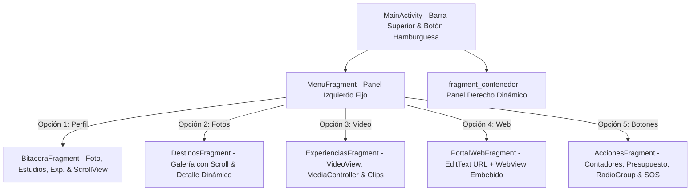

# NativeSquad - Guía de Viajes Turísticos (HPM)
### Proyecto Final: Entrega 3 y Sustentación (Semanas 7 y 8)

Aplicación móvil nativa para el sistema operativo **Android** desarrollada para el módulo de **Herramientas de Programación Móvil I** de la **Institución Universitaria Politécnico Grancolombiano**.

---

## 👥 Equipo de Trabajo (NativeSquad HPM)

* **Sandra Milena Millan Alvarez**
* **Miguel Angel Mendoza Niño**
* **Juan José Muñoz Valencia**
* **Julio Ernesto Murillo Cocunubo**

**Docente / Tutor:** Víctor Fabián Castro Pérez  
**Facultad:** Facultad de Ingeniería, Diseño e Innovación  
**Repositorio Oficial:** [https://github.com/MiguelAngel-Mendoza/NativeSquad](https://github.com/MiguelAngel-Mendoza/NativeSquad)  
**Versión:** 3.0 (Entrega Final y Sustentación - Semanas 7 y 8)

---

## 📱 Arquitectura de la Aplicación

La aplicación implementa una arquitectura modular basada en **pantalla dividida horizontalmente** (patrón Master-Detail en tiempo real) con dos secciones principales sincronizadas:

1. **Panel Izquierdo Fijo (`MenuFragment`)**:
   * Menú vertical permanente con 5 accesos directos temáticos: **Perfil**, **Fotos**, **Video**, **Web** y **Botones**.
   * Resaltado visual del elemento activo con micro-interacciones.
2. **Panel Derecho Dinámico (`FrameLayout` / `fragment_contenedor`)**:
   * Contenedor que muta su contenido mediante `FragmentTransaction` y `FragmentManager` con animaciones de transición fluidas sin recargar la actividad principal.
3. **Barra Superior (`top_action_bar`)**:
   * Botón de torta / menú hamburguesa para ocultar y desplegar el panel izquierdo dinámicamente (`View.GONE` / `View.VISIBLE`), permitiendo un modo de pantalla completa expandido.

---

## Trazabilidad Estricta con la Rúbrica de Evaluación (Entrega Final)

| Opción de Menú (Izquierdo) | Submódulo Android (Derecho) | Componentes Clave | Requerimiento Oficial de la Rúbrica |
| :--- | :--- | :--- | :--- |
| **Perfil** | `BitacoraFragment` | `ImageView`, `ScrollView`, `CardView`, `TextView` | **Muestra el perfil de una persona:** Fotografía de perfil, datos personales, formación académica y experiencia laboral. Incluye barras de desplazamiento vertical (`ScrollView`) en los campos tipo texto para optimizar la pantalla, junto con un selector dinámico para consultar los 4 perfiles del equipo. |
| **Fotos** | `DestinosFragment` | `RecyclerView`, `ImageView`, `CardView`, `ScrollView` | **Lista de imágenes con barra de desplazamiento (scroll):** Galería fotográfica vertical en `RecyclerView` que muestra la descripción detallada (historia, geografía, clima y actividades) de cada imagen en un panel superior al ser seleccionada. |
| **Video** | `ExperienciasFragment` | `VideoView`, `MediaController`, `ProgressBar`, `MaterialButton` | **Muestra un video con sus controles de reproducción:** Reproductor nativo `VideoView` con barra táctil `MediaController`, controles programáticos (Play, Pausa, Replay) y selector de clips HD locales desde `res/raw`. |
| **Web** | `PortalWebFragment` | `EditText`, `MaterialButton`, `WebView`, `ProgressBar` | **Permite cargar una página Web cuya URL se digita en una caja de texto:** Barra de dirección editable, botón Cargar, `WebViewClient` interno para retener la navegación en la app, barra de progreso y marcadores de acceso rápido. |
| **Botones** | `AccionesFragment` | `MaterialButton`, `RadioGroup`, `AlertDialog`, `TextView` | **Cualquier ejemplo donde muestren el uso de botones:** Contador interactivo de itinerario, botón toggle de favoritos con conmutación dinámica de icono/texto, calculadora de presupuesto con contadores (+/-), `RadioGroup` y diálogo modal de auxilio SOS (`AlertDialog`). |

---

## 📄 Documentación Oficial de la Entrega 3

Los documentos consolidados con todo el código XML, código Java, diagramas, capturas y guion de sustentación se ubican en la carpeta `DOCX/`:

* 📘 **Documento Maestro en Markdown:** [`DOCX/ENTREGA_3_FINAL_NATIVESQUAD.md`](DOCX/ENTREGA_3_FINAL_NATIVESQUAD.md)
* 📕 **Documento Oficial en Formato Word:** [`DOCX/Entrega_3_Final_Semanas_7_y_8_NativeSquad.docx`](DOCX/Entrega_3_Final_Semanas_7_y_8_NativeSquad.docx)

### Estructura del Documento Entregable:
* **Sección A:** Documento de la Entrega 1 (Introducción, justificación, objetivos, requerimientos RF/RNF, arquitectura y wireframes).
* **Sección B:** Pantallazos de la aplicación en ejecución para cada uno de los módulos y vista expandida.
* **Sección C:** Interfaz gráfica junto con su código XML completo y documentado.
* **Sección D:** Código Java de la aplicación con manejo de ciclo de vida y eventos táctiles.
* **Sección E:** Conclusiones y recomendaciones técnicas.
* **Sección F:** Guion y ficha técnica de sustentación con asignación de roles para Sandra Millan, Miguel Mendoza, Juan Muñoz y Julio Murillo, junto con el banco de preguntas típicas del tutor Víctor Fabián Castro Pérez.

---

## 🛠️ Stack Tecnológico

* **Plataforma:** Android Nativo
* **Lenguaje de Programación:** Java (JDK 17)
* **SDK Compilación (Target SDK):** 34 (Android 14)
* **SDK Mínimo (Min SDK):** 24 (Android 7.0 Nougat)
* **Diseño UI:** AndroidX, Google Material Design Components 3, LinearLayout, FrameLayout, ConstraintLayout y CardView
* **Gestor de Construcción:** Gradle 8.2 & Android Gradle Plugin 8.2.2

---

## 💻 Instrucciones de Compilación y Ejecución

### Desde Android Studio:
1. Abrir Android Studio y seleccionar **Open...**
2. Elegir la carpeta raíz `Herramientas-Programacion`.
3. Sincronizar Gradle (*Sync Project with Gradle Files*).
4. Seleccionar un emulador (ej. Pixel 6 API 34) o dispositivo físico conectado por depuración USB y presionar **Run 'app'** (`Shift + F10`).

---
*Politécnico Grancolombiano • Facultad de Ingeniería, Diseño e Innovación • Octubre 2026*
